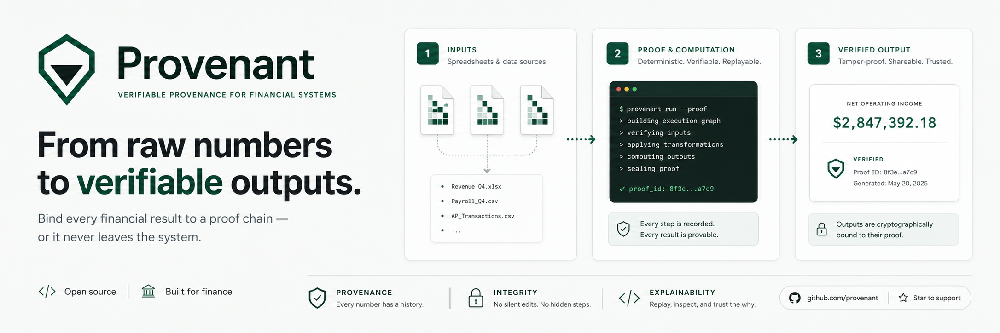

<div align="center">
  
</div>

---

<div align="center">

<p>Provenance for finance workflows, with evidence you can verify and replay.</p>

[](https://github.com/humzakhan/provenant/actions/workflows/ci.yml)
[](LICENSE)
[](https://pkg.go.dev/github.com/humzakhan/provenant)
[](https://goreportcard.com/report/github.com/humzakhan/provenant)
<br />
<p><strong>Supported MCP hosts</strong></p>
<p>
  
  
  
  
  
</p>
<p>
  
  
  
  
  
</p>
<br />
</div>

Provenant is a provenance layer for finance workflows: it records where every output number came from and packages the evidence for verify/replay. It sits between source files, agent/tool reads, numeric claims, and the final answer that a finance team is willing to release. It enforces four guarantees across every supported read path: non-bypassable exit, fail-closed errors, schema-first validation, and deterministic replay — designed for SR 11-7 / FINRA 2026 contexts where controllers, audit leads, and compliance officers need a verifiable audit chain from raw bytes through to a replayable bundle.

> **Status: v0 / pre-1.0 — early and actively evolving. APIs may change without notice between minor releases.**

---

## The Problem

Finance teams increasingly ask AI systems practical questions over local exports, close packages, reconciliation workbooks, and customer/vendor schedules:

- "What was revenue for Q1?"
- "Why does booked revenue not match cash received?"
- "Which customers still owe us money, and who is the largest balance?"

Those questions are hard not because the arithmetic is exotic, but because the answer is only useful if the organization can later prove where every number came from. A polished paragraph from Claude Code, Codex, or another agent workspace is not enough for a controller, auditor, or model-risk reviewer.

The failure mode Provenant is built to prevent: an answer can be directionally correct, well written, and still impossible to audit. If a released answer says revenue was `$395,061.13`, the reviewer must be able to inspect the captured read, the token, the hash-chained audit entry, and the bundle that replays that value — not just trust the model's prose.

---

## How It Works

The core loop turns raw source bytes into evidence you can verify and replay
offline. Each stage enforces one of Provenant's guarantees (right column).

```text
        ┌─────────────────────────────┐
        │  source bytes               │   CSV · XLSX · JSON exports
        └──────────────┬──────────────┘
                       │
                       ▼
        ┌─────────────────────────────┐
        │  SourceReader.Read           │ ─── schema-first validation
        │    → CapturedRead            │     (bad input never enters)
        │    → ReadResult              │
        └──────────────┬──────────────┘
                       │
                       ▼
        ┌─────────────────────────────┐
        │  kernel.MintToken            │ ─── non-bypassable exit
        │    → grounded numeric token  │     (no read ⇒ no token)
        └──────────────┬──────────────┘
                       │
                       ▼
        ┌─────────────────────────────┐
        │  AuditSink.AppendAuditEntry  │ ─── hash-chained, tamper-evident
        └──────────────┬──────────────┘
                       │
                       ▼
        ┌─────────────────────────────┐
        │  bundle.Snapshot             │ ─── fail-closed on any error
        │    → bundle bytes + SHA-256  │
        └──────────────┬──────────────┘
                       │
                       ▼  offline, no kernel needed
        ┌─────────────────────────────┐
        │  bundle.Verify               │ ─── deterministic replay
        │  bundle.Replay               │     (same bytes ⇒ same result)
        └─────────────────────────────┘
```

For the full provenance model — kernel guarantees, token anatomy, and the distinction from logging — see [docs.provenant.sh/concepts/provenance-model](https://docs.provenant.sh/concepts/provenance-model/).

---

## Installation

**As a library:**

```bash
go get github.com/humzakhan/provenant
```

**CLI binary:**

```bash
go install github.com/humzakhan/provenant/cmd/provenant@latest
```

**Build from source:**

```bash
git clone https://github.com/humzakhan/provenant
cd provenant
go build ./...
go test ./...
```

**Install into an MCP host:**

```bash
provenant install --target claude
provenant install --target codex,cursor
provenant install --target all
provenant install --print-config codex
```

Claude Code gets project hooks and Stop-hook enforcement; all other listed hosts get MCP tool access plus `provenant.submit_answer` attestation for official answers.

---

## Status

Provenant is v0 / pre-1.0: the kernel, CLI, MCP surface, and Claude Code hooks are functional; some surfaces (HTTP, MCP reconcile tool, arbitrary-CSV reasoning) are not yet complete.

Full capability status: [docs.provenant.sh/reference/status-matrix](https://docs.provenant.sh/reference/status-matrix/) · [docs.provenant.sh/guarantees-and-limits](https://docs.provenant.sh/guarantees-and-limits/)

---

## Quickstart

Run a read-mint-bundle against a local request file:

```bash
go run ./cmd/provenant read-mint-bundle --request request.json
```

The resulting bundle can be shared with reviewers and verified offline without access to the original Provenant runtime.

Full quickstart — including the request schema, reconcile fixture, verify/replay, and Go API usage — at [docs.provenant.sh/quickstart/current-artifacts](https://docs.provenant.sh/quickstart/current-artifacts/).

---

## Examples

- [`examples/reconciliation/README.md`](examples/reconciliation/README.md) — reconciliation fixture, expected outputs, and seven failure fixtures
- [`examples/derivation-graph/README.md`](examples/derivation-graph/README.md) — derivation-graph trace from raw CSV rows to operating income
- [`examples/fauxbooks-user-scenarios/README.md`](examples/fauxbooks-user-scenarios/README.md) — end-to-end Fauxbooks finance scenarios with grounded Claude Code answers

---

## Project Layout

```text
kernel/        Pure Go enforcement kernel: readers, minting, audit chain, bundle.
access/        CLI runner, MCP surface, install path, check-answer, and tests.
reconcile/     Reconciliation engine, request schema, report generation.
hack/          Hook scripts and end-to-end runners.
examples/      Fixture inputs and runnable examples.
cmd/provenant/ CLI binary entry point.
```

See [`architecture/README.md`](architecture/README.md) for a full repo navigation map.

---

## Documentation

**At [docs.provenant.sh](https://docs.provenant.sh):**

- Concepts: [provenance-model](https://docs.provenant.sh/concepts/provenance-model/) · [modes](https://docs.provenant.sh/concepts/modes/)
- Guides: [review-audit-evidence](https://docs.provenant.sh/guides/review-audit-evidence/) · [integrate-go-library](https://docs.provenant.sh/guides/integrate-go-library/) · [extend-source-tools](https://docs.provenant.sh/guides/extend-source-tools/)
- Architecture: [overview](https://docs.provenant.sh/architecture/overview/) · [ADRs](https://docs.provenant.sh/architecture/adrs/)
- Reference: [status-matrix](https://docs.provenant.sh/reference/status-matrix/) · [current-surfaces](https://docs.provenant.sh/reference/current-surfaces/)

**In this repo:**

- [`ROADMAP.md`](ROADMAP.md) — planned milestones
- [`docs/thesis.md`](docs/thesis.md) — design principles and invariant rationale
- [`docs/KNOWN_TRADE_OFFS.md`](docs/KNOWN_TRADE_OFFS.md) — known trade-offs
- [`docs/OPEN_QUESTIONS.md`](docs/OPEN_QUESTIONS.md) — open design questions
- [`architecture/tools/extract/README.md`](architecture/tools/extract/README.md) — reader contracts and selector reference

---

## Contributing

Contributions are welcome. Please read [`CONTRIBUTING.md`](CONTRIBUTING.md) before opening a pull request and follow the [`CODE_OF_CONDUCT.md`](CODE_OF_CONDUCT.md).

To report a security vulnerability, see [`SECURITY.md`](SECURITY.md).

---

## License

Provenant is released under the [MIT License](LICENSE).
